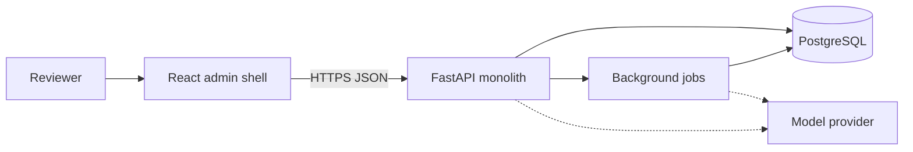
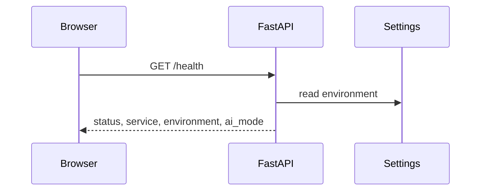
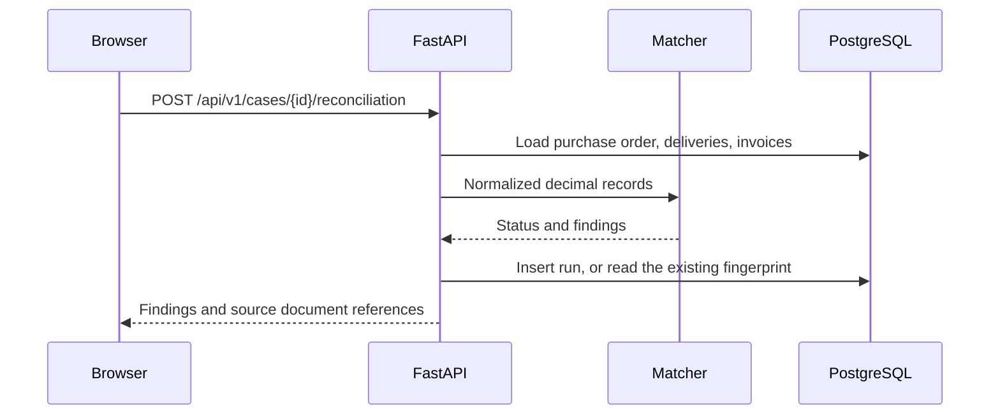
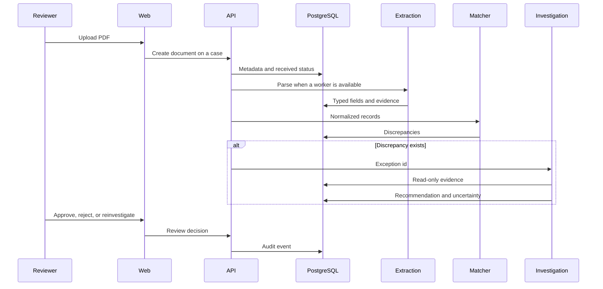
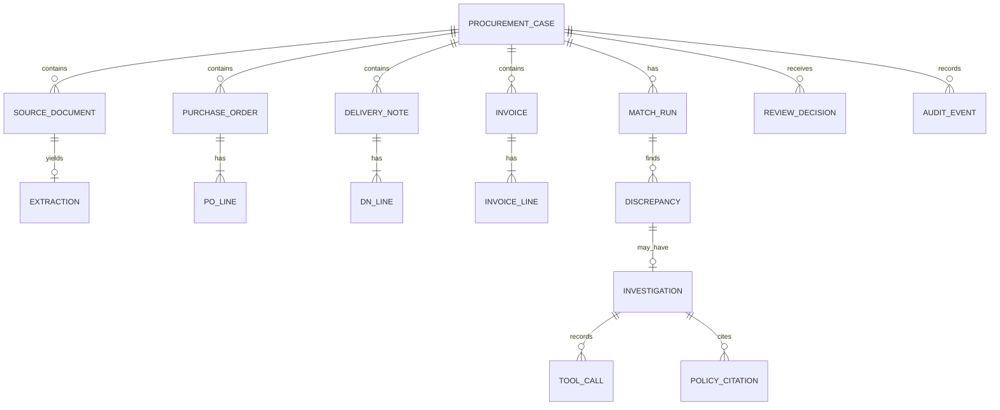
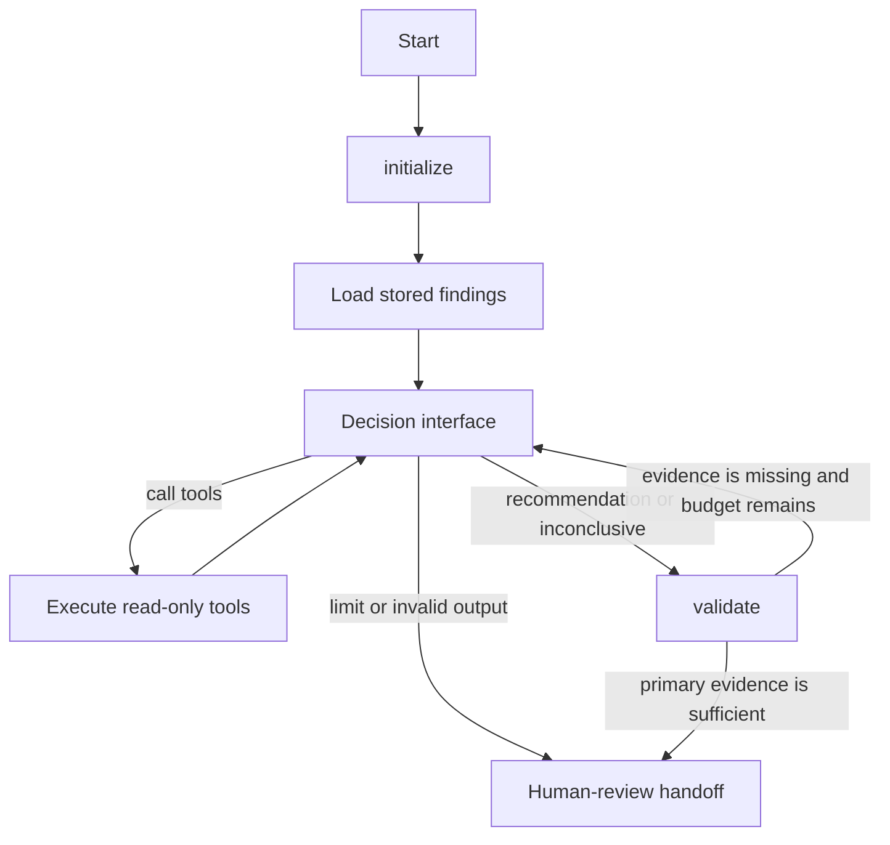
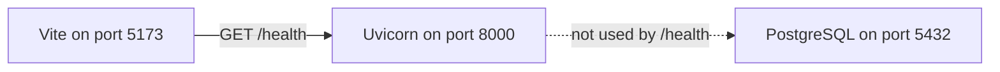
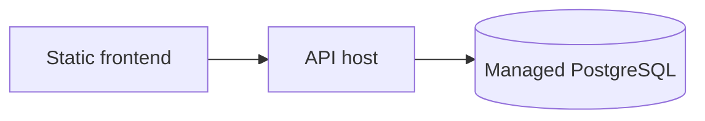

# ProcureFlow AI — Architecture

**Status:** foundation, deterministic matcher, a bounded mock investigation, a gated OpenAI investigation adapter, an evidence-sufficiency gate, and a document pipeline whose default extractor is a test double, updated 2026-11-17.  
**Implemented today:** a modular FastAPI process, configuration, structured request logs, `GET /health`, SQLAlchemy models and Alembic revisions through `20261117_0006`, a pure three-way matcher, a development-only synthetic seed, versioned case, document, and investigation APIs, PDF intake with local content-addressed storage, PyMuPDF text extraction, a mock document extractor, a gated OpenAI extraction adapter that is not enabled, validation before acceptance, a mock-only extraction evaluation, a mock completion provider, a LangGraph investigation, a deterministic evidence check that can send the model back for more tools, lexical policy retrieval, an OpenAI Responses investigation adapter that is not enabled, separate persistence for mock and live attempts, Docker Compose for local PostgreSQL, GitHub Actions for backend tests (with PostgreSQL) and the frontend build, and a React admin shell with an overview, documents, and procurement cases.

OCR, semantic retrieval, a recorded approval decision, and deployment are still designs. The default investigation and the default extractor do not call a model. Neither live adapter was invoked while it was added. Uncertain choices are marked as proposals.

The product intent lives in [PROJECT_VISION.md](PROJECT_VISION.md). This file is the technical reference for subsequent work.

## Architectural overview

ProcureFlow AI is a modular monolith. One backend process owns the HTTP API, the domain rules, and the persistence boundary. Long-running work can later move to a worker in the same codebase. The frontend is a separate static application.

The monolith is a deliberate first shape. The workflows share one database and one transaction model. Splitting them into services would add network failure modes before there is a scaling measurement that justifies the split.



Solid arrows are the foundation we can run locally, except the worker, which is not implemented. Dashed arrows are the planned model boundary. In the default configuration the provider is an in-process mock and opens no network connection.

## Principles

1. **Interpretation and authority are different components.** A model may propose structure or an explanation. Quantities, money, tolerances, and match verdicts are computed in tested Python.
2. **Contracts are explicit.** HTTP payloads, extraction records, tool inputs, and tool outputs are Pydantic models. Invalid data is a result, not a guessed value.
3. **Side effects are narrow.** The investigation agent, when it exists, gets read-only tools. It cannot approve a payment.
4. **State transitions are visible.** Processing status, match status, investigation status, and review decisions are stored. Private chain-of-thought text is not stored.
5. **Untrusted input stays data.** Uploaded files and retrieved text are not instructions to the application.
6. **No speculative layers.** A module is added when a behavior needs it. The current tree does not contain empty domain services.

## Major components

| Component | Responsibility | Status |
| --- | --- | --- |
| React shell | Navigation, theme, overview, and procurement cases | Implemented |
| FastAPI application | HTTP, configuration, CORS, request logging, domain errors | Implemented |
| Settings | Environment and `.env` loading, including `AI_MODE` | Implemented |
| AI provider boundary | `complete()` stays on the mock. The investigation adapter can call OpenAI and is gated off | Implemented |
| Persistence | Engine, session, procurement and document tables, Alembic through `20261117_0006` | Implemented |
| Case and reconciliation API | List, detail, run, and read findings under `/api/v1` | Implemented |
| Matching engine | Pure decimal comparison and persisted findings | Implemented |
| Synthetic seed | Idempotent fixtures for five scenarios, development environments only | Implemented |
| Document intake | File checks, content hash, local storage, status, duplicate upload | Implemented. Object storage is not |
| Extraction pipeline | Page text, typed fields, and source snippets | Implemented for the mock extractor. The OpenAI extractor is gated off. OCR is not implemented |
| Normalization | Validate and map an accepted extraction onto purchase orders, deliveries, and invoices | Implemented. Acceptance is explicit and does not overwrite an existing record |
| Investigation workflow | LangGraph tool selection, budgets, validation, and human-review handoff | Implemented. Default selector is a test double. OpenAI selector is gated off |
| Policy retrieval | Versioned synthetic policies and lexical citations | Implemented. Semantic retrieval is not |
| Review and audit | Human decision and trace of state changes | Planned. Investigation events are stored; a person cannot record a decision yet |
| Worker | Asynchronous jobs, retries, idempotency keys | Planned |
| External ERP | Simulated outbound adapter | Planned |

### Backend layout

```
backend/
  app/
    main.py                 # process composition
    api/routes/             # health and /api/v1 procurement routes
    api/presenters.py       # ORM rows to response models
    schemas/                # API contracts
    domain/matching/        # pure matcher, no I/O
    domain/scenarios.py     # synthetic fixtures
    domain/policies.py      # synthetic policy corpus
    domain/investigation.py # decision and recommendation contracts
    services/               # queries, retrieval, investigation persistence
    core/                   # settings and logging
    db/                     # engine, session, SQLAlchemy models
    ai/                     # completion provider, investigation test double, gated OpenAI adapter
  alembic/                  # migration chain
  tests/
```

HTTP stays in `api`, request and response models in `schemas`, and SQLAlchemy models in `db`. The matcher does not import FastAPI or SQLAlchemy.

### Frontend layout

The UI is the MIT-licensed [shadcn-admin](https://github.com/satnaing/shadcn-admin) template, commit `e16c87f213a5ba5e45964e9b67c792105ec74d26`, with sample product pages removed. The license file remains in `frontend/LICENSE`. Shared UI primitives, the sidebar shell, theme controls, and error pages remain because later case and review screens will need them.

`src/lib/api.ts` is the backend client. It validates health, cases, seed, and reconciliation payloads with Zod.

The route group is still named `_authenticated` because that is the template's pathless layout. It does not check a session.

## Main data flows

### Flow implemented now



`/health` does not open a database connection and does not build an AI provider. It reports the configured mode so a mis-set `AI_MODE` is visible. It is a liveness check, not readiness.

### Reconciliation flow implemented now

The cases API reads PostgreSQL. Triggering reconciliation loads the stored lines, calls the pure matcher, and commits one run plus its findings. A second trigger with the same lines and the same engine version returns that run instead of inserting another. The browser does not calculate quantities. An investigation, when one is requested, reads that stored run. It does not call the matcher again.



### Target document flow



Extraction is asynchronous in the target design because parsing is slow and fallible. The matcher is synchronous and pure: given records, it returns a report, and the API persists that report inside a transaction. The investigation is also synchronous today. It finishes inside the request because the decision step is a local test double and every tool is a database read. A live model would be a reason to move that work to a worker.

## Target domain model

The procurement, policy, and investigation tables exist. Extraction, review, and audit records are still absent. A case has one purchase order, zero or more delivery notes, and zero or more invoices. Money and quantity columns are `NUMERIC(18, 4)`. API JSON sends them as decimal strings. An investigation belongs to one reconciliation run. A run can have more than one attempt, including one mock attempt and more than one live attempt. Earlier attempts stay stored.



Supporting records, also planned:

- **Product match candidate.** A possible link between lines, with a reason such as shared identifier, shared reference, or semantic similarity. Only an identifier match or an accepted human decision authorizes a financial comparison.
- **Policy document and chunk.** Retrieval corpus. A citation points at a chunk id, not at a free-text memory of the policy.
- **Usage record.** Provider, model, token counts, estimated cost, and the workflow id that caused them.
- **Idempotency key.** On document processing, so a retry does not create a second extraction result.

Money is `NUMERIC` in PostgreSQL and `Decimal` in Python. Floats are not used for quantities or prices.

## API design principles

- Resource-oriented JSON under a versioned prefix when the first business route appears. `/health` stays at the root so a process probe does not depend on the version prefix.
- Request and response models are the contract. The database model is not the response model.
- Errors use a stable `code` and a human `detail`. Validation errors name the field. They do not echo secrets or document contents by default.
- Write operations that can be retried take an idempotency key.
- The browser origin is an explicit CORS allow-list (`CORS_ORIGINS`). Credentials are not paired with `*`.
- OpenAI credentials are read only on the server, and only by the real provider once it exists. No response schema includes them.

## Document processing pipeline

Implemented as a synchronous request path. There is no worker. Stages recorded on the upload are `received`, `parsed`, `extracted`, then `needs_review`, `accepted`, or `failed`.

1. **Accept the file.** The upload must be `application/pdf` or `application/octet-stream`, start with `%PDF-`, and stay under `DOCUMENT_MAX_BYTES`. Empty files and a bad signature are rejected before storage. The SHA-256 is the storage key. The same bytes and the same extractor return the existing extraction. A stored mock extraction is not reused when the process is configured for live extraction. The file name is display metadata only.
2. **Parse.** PyMuPDF reads page text, page numbers, text blocks, and a small metadata set. More than `DOCUMENT_MAX_PAGES`, an encrypted file, or a file that does not open is rejected and not stored. A page set with almost no text is `image_only_pdf`. `UnavailableOcrFallback.implemented` is false, and the recovery function does not call it.
3. **Extract.** `MockDocumentExtractor` is the default. It reads labeled page text from the synthetic layouts and is marked `mocked`. `OpenAIDocumentExtractor` uses the Responses API with a strict schema and is constructed only when `AI_MODE=openai`, `DOCUMENT_EXTRACTOR=openai`, `EXTRACTION_LIVE_ENABLED=true`, and a server key are all set. Its estimated budget is `EXTRACTION_MAX_ESTIMATED_COST_USD`, separate from the investigation budget. Neither path classifies a file from its name or hash. Missing fields stay null. Prompt-injection phrases are flagged and not treated as instructions.
4. **Validate.** Python `Decimal` checks quantities, prices, and stated totals. A contradiction is a blocking warning. The stated numbers are not rewritten. An unresolved product code is advisory. Tax is checked on the extraction and is not written onto the invoice table or compared by the matcher.
5. **Accept.** `POST /api/v1/documents/{id}/accept` is the only path that writes a purchase order, delivery note, or invoice from an extraction. It creates or attaches an `origin=upload` case and then runs the matcher. A supplier and document number that already exist return 409 and leave the existing row unchanged. Seeded cases stay `origin=synthetic_seed`.
6. **Investigate** through the existing endpoint when the match report contains an exception.

Processing is not a queue. A duplicate hash is the retry for the same bytes and the same extractor. A different extractor adds a row and does not delete the other one. A second accept returns the case already created from the extraction that was accepted. Accepting a file that was accepted from the other extractor does not rewrite the procurement records.

## Matching engine

Implemented as `reconcile` in `app/domain/matching/engine.py`. It is a pure function: normalized records in, a report out. It does not call a model, a database, or the clock. Repeated calls with the same input return the same report. Persisted runs are idempotent on a SHA-256 of the canonical input plus engine version `1`.

Lines align only when they share a product code. A blank code is missing. Similar or identical descriptions do not authorize a financial comparison; those lines produce `UNCERTAIN_PRODUCT_MAPPING` and the run status is `NEEDS_REVIEW`. That status outranks `EXCEPTION`, because an unresolved identity can make a quantity gap misleading. Findings still keep their own status.

Comparison rules that are implemented:

1. One purchase order per case. A missing purchase order is `MISSING_PURCHASE_ORDER`. A delivery note or invoice that omits the purchase-order number is `MISSING_REFERENCE`. A cited number that is not the case purchase order is `REFERENCE_MISMATCH`. Quantity comparison still uses the lines already attached to the case.
2. Delivery quantities for one product code are summed across delivery notes. Invoice quantities are summed the same way. A missing side is zero for that product.
3. Material gaps use an absolute tolerance. The default is zero, so `100` and `80` produce `ORDERED_NOT_DELIVERED` and `INVOICED_WITHOUT_DELIVERY` with difference `20`.
4. Invoice and purchase-order unit prices are compared with `Decimal` when the unit and the currency are each a single value. A difference is `PRICE_MISMATCH` and is signed invoice minus purchase order.
5. More than one unit, after case-insensitive comparison, is `UNIT_MISMATCH`. Quantities and prices are not subtracted and no conversion table is applied. `BAG` and `KG` stay different. `bag` and `BAG` are the same unit.
6. More than one currency is `CURRENCY_MISMATCH`. No exchange rate is invented. A priced line with no currency is `MISSING_CURRENCY`.

Run status is `MATCHED` only when every finding is `MATCHED`. The five synthetic scenarios are `CASE-A-CLEAN`, `CASE-B-QUANTITY`, `CASE-C-AMBIGUOUS`, `CASE-D-PARTIAL`, and `CASE-E-PRICE`.

The earlier proposal also included duplicate detection, stated-total recomputation, and tax comparison. Those are not implemented. Semantic candidate matches are not implemented either; the matcher does not propose that two descriptions are the same product.

## Agent workflow

The investigation is the part that can be agentic. Matching stays deterministic.

The implemented graph is a LangGraph state machine. A deterministic node loads the stored reconciliation findings for the bound run. The next node asks a decision interface which read-only tool to call, or whether to stop with a recommendation or an inconclusive result. Tool execution, budget checks, output validation, and the human-review handoff are ordinary code.



`validate` checks two different things. First it rejects a citation or evidence label the tools did not return. That is `invalid_output`. Then it checks primary line evidence for the finding type. A purchase-order header is not a purchase-order line. A document number that appears only in the matcher finding is not a retrieved line. Quantity findings need the purchase-order line, every referenced delivery-note line, the invoice line, and `POL-QTY-001`. Price findings need the priced purchase-order line, the priced invoice line, and `POL-PRICE-001`. They do not need a delivery note. An uncertain product mapping needs the source descriptions, the product-reference fields, `POL-PROD-001`, and an explicit statement that equivalence is not established.

If that check fails, the outcome is not stored as complete. The workflow records the missing categories and asks the same decision interface to continue. The interface still chooses the tools. The check does not emit a tool sequence. A repeated terminal decision that adds no new tool results, or an execution limit reached after a rejection, becomes `inconclusive` and lists the missing evidence. The workflow does not invent a line to make the check pass. A quantity credit that says the remaining units will never be delivered is rejected. The scripted quantity result asks the supplier to clarify and says a credit is appropriate only if the supplier confirms the balance will not arrive.

The decision interface is provider-independent. `AI_MODE=mock` selects `MockInvestigationModel`, a deterministic test double. It branches on the finding codes and on which tools have already returned, so a quantity case, a price case, and an uncertain-product case do not follow one fixed tool list. That branching is scripted. It is not language-model reasoning, and the API and the cases screen say **Mock investigation**.

`OpenAIInvestigationModel` is the live decision step. It is constructed only when `AI_MODE=openai`, `INVESTIGATION_LIVE_ENABLED=true`, and `OPENAI_API_KEY` is a non-empty server-side secret. The HTTP body cannot set those. The completion factory never builds an OpenAI client. The default configuration therefore cannot spend, even if a key is present in the environment and the live flag is false, or if the flag is true and the key is absent.

The live step calls `responses.create` on the official Python SDK. The request sends `store=false`, `max_retries=0`, `tool_choice=auto`, and strict function schemas for the six read-only tools plus `record_investigation_outcome`. The outcome function is not passed to the tool executor. Its arguments are validated with Pydantic and then checked again by the workflow against retrieved evidence. The model chooses the tools. The adapter does not contain the mock's finding-code branches and does not recompute quantities or prices.

After a tool round, the next request's `input` is the prior response output plus one `function_call_output` per call id. Reasoning items are copied with their ids and `encrypted_content`. The request asks for that content with `include: ["reasoning.encrypted_content"]`. The list lives on the model instance until the investigation function returns. It is how the Responses API continues a turn when `store` is false. Those items are not copied into investigation events, summaries, or logs. `previous_response_id` is not used, because a stored response would keep the turn on the provider side.

Before each request the adapter reserves a cost: prompt characters divided by two, plus a margin, for input, and `investigation_max_output_tokens` for output, priced from the configured table. If the reservation exceeds the remaining investigation budget, or the model-request cap is already met, or no time remains, the request is not sent. The reservation is an estimate. A sent request can still cost more than predicted. The workflow then records the provider's token counts when they are present, or the reservation when they are not, and drops the recommendation if the running estimate passes the budget. The default table is `gpt-5.4-mini` at $0.75 per million input tokens and $4.50 per million output tokens. The default investigation budget is $0.10. The screen calls that USD figure an estimate, not an invoice.

Refusals become an inconclusive result and the refusal text is not stored. Incomplete output, free text, a schema miss, or `review_required` set to false become `invalid_output`. Timeouts become `timed_out`. Provider errors become `failed`, with a fixed sentence rather than the provider body. None of these paths were exercised against the live API. The tests use a fake transport.

Read-only tools, all validated and bound to the investigation's case:

- `get_procurement_case`
- `get_reconciliation_findings`
- `get_purchase_order`
- `get_delivery_notes`
- `get_invoices`
- `search_procurement_policy`

A tool that is asked for a different case id returns `case_access_denied` and does not read that case. There is no approve, pay, or write tool. Document and policy text is marked untrusted. Instruction-like phrases are recorded and are not allowed to change the tool arguments or the recommended action.

Termination is one of: a validated recommendation (`completed`), an explicit inconclusive result, `invalid_output`, `step_limit`, `budget_exceeded`, `timed_out`, or `failed`. Limits come from settings: iterations, model requests, tool calls, output tokens, timeout, and estimated cost. The mock records zero tokens and zero cost. Crossing a limit stores no recommendation that could be mistaken for an approval. Every stored investigation has `review_required` true and `payment_authority` false. The result does not include a confidence percentage.

The persisted record contains the case, the reconciliation run, status, tool events, evidence labels, policy citations copied from the retrieved sections, structured findings, the recommended action, unresolved issues, errors, timestamps, and token and cost figures. It does not contain hidden chain-of-thought. Event payloads reject keys such as `reasoning` and `chain_of_thought`.

Investigations are immutable rows. A repeat request for the same run and AI mode returns the latest attempt and does not start another one. A new attempt is created only when the request sends `X-Investigation-Attempt: new` and an `Idempotency-Key`. The same key returns that attempt. A mock row is not returned for a live request, and no attempt is overwritten. `evidence_validated` is true only when the sufficiency check accepted the outcome. A stored HTTP success can therefore be distinct from an evidence-validated investigation. The first live CASE-B row stays as it was recorded. The work is synchronous and finishes before the response. A matched reconciliation cannot be investigated.

Example, case `CASE-B-QUANTITY`, mock mode. The matcher had already stored ordered 100, delivered 80, invoiced 100. The test double loaded those findings, then selected the case, purchase order, delivery note, and invoice, then searched policy. The validated result recommends `request_supplier_clarification`, says the remaining quantity may still be delivered, and cites `POL-QTY-001`, `POL-APR-001`, `POL-DEL-001`, and `POL-SUP-001`, each version 1.0. The summary quotes the matcher figures and the retrieved document numbers and says that no invoice was approved and no payment was initiated. Recorded usage is 0 tokens and 0 USD. The same shape for `CASE-C-AMBIGUOUS` is `inconclusive` with `escalate_product_identity`. `CASE-E-PRICE` recommends `hold_for_price_review` and does not call `get_delivery_notes`, because the scripted price branch does not need the delivery note once the matcher has recorded the price gap.

## RAG architecture

Implemented retrieval is lexical. `policy_sections.search_vector` is a stored `to_tsvector('english', heading || ' ' || body)` column with a GIN index. A query is tokenized and the tokens are OR-ed, then ranked with `ts_rank`. A citation stores the section id, code, version, heading, and the section body that was retrieved. The recommendation cannot attach a section that the search did not return, and it cannot supply its own policy text.

The corpus is six synthetic version 1.0 policies: partial deliveries (`POL-DEL-001`), quantity discrepancies (`POL-QTY-001`), price discrepancies (`POL-PRICE-001`), invoice approval (`POL-APR-001`), ambiguous product references (`POL-PROD-001`), and supplier clarification (`POL-SUP-001`). `ensure_policy_corpus` inserts a missing code and does not overwrite an existing one. The development seed calls it. An investigation calls it too, so policies appear without deleting cases that were seeded earlier.

`SemanticPolicyRetriever` raises `NotImplementedError`. `build_policy_retriever` returns the lexical retriever only. The Compose image is still `pgvector/pgvector:pg16`, and the extension is still not created. Embeddings are not installed. Calling the current search semantic would be false.

Lexical search can return a section that shares words with the query but is not the section the recommendation cites. The citation list, not the full search hit list, is the set of policies the result relies on.

## Persistence and state management

- PostgreSQL is the system of record.
- SQLAlchemy 2 is the ORM and the core expression layer. Sessions are request-scoped, `autoflush` is off, and `expire_on_commit` is off so loaded values remain readable after commit. This session policy is configured now and unused by routes.
- Alembic owns the schema. The head revision is `20261117_0006`. `20261116_0001` remains an empty baseline. `20261117_0005` allows one investigation per run and AI mode, and one extraction per upload and provider. `20261117_0006` adds an attempt number, an idempotency key, and an evidence-validated flag. Existing investigation status, summary, and action values are not rewritten.
- A transaction wraps one state change: saving an extraction, saving a match run, or saving a review decision. The matcher does not open a session.
- Jobs, when added, record `queued`, `running`, `succeeded`, and `failed`, plus attempt count and the last error class. The worker claims work in a transaction so two workers cannot run the same job.

## Security boundaries

| Boundary | Rule |
| --- | --- |
| Browser | Receives only `VITE_` configuration. The only value shipped today is the API base URL. |
| API process | Reads `DATABASE_URL`, `AI_MODE`, the two live flags, the document limits, and `OPENAI_API_KEY` from the environment. The key is read only when a live gate is open. |
| Repository | `.env.example` contains local defaults and a commented key name. Real `.env` files and `var/` are gitignored. |
| Model provider | The OpenAI SDK is installed. A client is created only for an investigation or extraction whose live gates are open. The default process does not create one. The two gates are independent. |
| Uploads | Size, declared type, and the `%PDF-` signature are enforced. Bytes are stored under `DOCUMENT_STORAGE_DIR`, outside the application package. The storage key cannot escape that directory. Page text is untrusted data. |
| Logs | Request id, method, path, status, and duration. Not bodies, not API keys, not chain-of-thought. |
| Tools | Implemented read-only investigation surface. No shell, no arbitrary HTTP, no write tool. |

Local Compose credentials (`procureflow` / `procureflow`) are development defaults. They are not a deployed secret, and they must not be reused on a public host.

CORS is an allow-list. Rate limiting is not implemented; add it before any route can trigger a paid call.

## Error handling strategy

- Invalid input: HTTP 422 with field errors.
- Missing entity: HTTP 404.
- Conflict, including an idempotency mismatch: HTTP 409.
- Provider disabled or budget exceeded: a domain error mapped to a client-visible status, with no partial "success" recommendation.
- Unexpected exception: HTTP 500 with FastAPI's default behavior. The server log includes the exception class and the request id. Domain errors use `{"code", "detail"}`.
- Request ids from `X-Request-Id` are echoed when they are short, ASCII, and printable. Otherwise the server generates one. This is implemented.

## Observability and testing strategy

Implemented:

- JSON logs on the root logger.
- Request id, method, path, status, and duration on completed requests.
- API tests for `/health`, CORS for the configured origin, and request-id handling.
- Provider tests: mock output is deterministic and costs zero; the completion factory rejects `openai`; the investigation factory does not construct a client unless `AI_MODE`, the live flag, and a server key are all set. Adapter tests use a fake Responses transport and do not open a socket.
- An engine test that the configured URL is parsed without opening a connection.
- Matcher unit tests for scenarios A–E, decimal sums, a 0.001 price gap, incompatible units, incompatible currencies, and missing product codes.
- API tests against PostgreSQL for seed idempotency, reconciliation replay, the quantity check constraint, investigation persistence, and the refusal of a matched run. They skip when PostgreSQL is not reachable. CI starts PostgreSQL.
- Investigation tests that do not open a database: quantity, missing evidence, tool failure, iteration and tool-call limits, timeout, invalid output, a citation that was not retrieved, prompt-like document text, and the cost ceiling. They use the test double.
- A migration test that the Alembic head is `20261117_0006`, plus a round trip down to the baseline and back up when PostgreSQL is running.
- Document tests for parsing, corrupt and oversized files, duplicate hashes, validation, decimal checks, provenance, mock and live separation, and an API path that uploads, accepts, reconciles, and investigates. The evaluation test scores the mock extractor. It does not call a model.

Planned, in the order the features appear:

- A recorded live investigation, after an explicit decision to spend. The adapter tests below use a fake transport, not a captured live response.
- Recorded model responses for extraction.
- A small evaluation runner over the synthetic dataset.
- Trace ids that tie a request to a job and an investigation.

OpenTelemetry is a reasonable later addition. It is not part of the current process. Investigation events are stored in PostgreSQL instead of being exported.

## Local development architecture



- Frontend: React, TypeScript, Vite, Tailwind, shadcn/ui, pnpm.
- Backend: Python 3.12, uv, FastAPI, Pydantic, SQLAlchemy, Alembic, pytest, Ruff.
- Database: Docker Compose service `postgres`, image `pgvector/pgvector:pg16`, host port 5432.
- The health check and the current tests run without Docker. Migrations and any future repository test need the database.
- The documented API bind and the frontend default are `127.0.0.1`, not `localhost`. On this machine `localhost` resolves to IPv6 first, and the API listens on IPv4 only. CORS allows both `http://localhost:5173` and `http://127.0.0.1:5173`.

Configuration files:

- Repository root `.env` for the backend. See `.env.example`.
- `frontend/.env` for `VITE_API_BASE_URL` only.

## Proposed deployment architecture

Not provisioned. No host, database project, or API key has been created.



- Frontend as static files, GitHub Pages if the build-time API URL is acceptable.
- API as a separate service. Render is one candidate.
- Managed PostgreSQL. Supabase is one candidate because it can provide Postgres; pgvector availability must be confirmed on the chosen plan before retrieval work depends on it.
- `AI_MODE=mock` on any public instance until a budget and an authentication story exist.
- Secrets only in the host's environment, never in the frontend build.

These providers are options. The choice is open and has not been tested.

## Cost control strategy

Implemented:

- `AI_MODE` is `mock` or `openai`. Default is `mock`.
- The mock completion and the investigation test double record zero tokens and zero cost.
- The completion factory refuses `openai` and does not construct a client.
- The investigation factory constructs a client only when `AI_MODE=openai`, `INVESTIGATION_LIVE_ENABLED=true`, and a non-empty server key are all set. The route body cannot supply them.
- The OpenAI package is a dependency. Importing it does not send a request. Tests fail if the default configuration constructs a client.
- A price table maps the configured model to USD per million tokens. The default row is `gpt-5.4-mini`: input `$0.75`, output `$4.50`. An unlisted model is not priced.
- Each live request records provider token counts when the response includes them. A missing usage object is charged at the pre-request reservation so the budget does not stay at zero.
- Before the request, the adapter reserves input from the prompt size and output at `investigation_max_output_tokens`. A shortfall, a model-request cap (default 6), or a spent clock skips the request.
- The default investigation budget is `$0.10`. The default extraction budget is `$0.05`. Application budgets are estimated safeguards, not guaranteed provider billing caps. Crossing the running estimate discards the recommendation. The client uses `max_retries=0`.
- The document extractor has its own gate and budget. A live extraction needs `DOCUMENT_EXTRACTOR=openai`, `AI_MODE=openai`, `EXTRACTION_LIVE_ENABLED=true`, and a server key. The default estimated ceiling is `$0.05` and `extraction_max_output_tokens` is 2000. The mock extractor records zero tokens and zero cost. The investigation budget is not spent by an extraction, and the extraction budget is not spent by an investigation.

Still required before the first real call:

- An explicit decision to spend. This iteration did not set the live flag and did not send a request.
- No anonymous public route that can reach the live gate. The current route is local. It still cannot spend while the flag is false.
- Rate limiting before that route is exposed.

The price table is an estimate. A reservation can be higher or lower than the invoice. Provider invoices remain the actual cost. The application must not present the estimate as an invoice or as a hard spending limit. Application budgets are estimated safeguards, not guaranteed provider billing caps.

## Technical trade-offs

| Choice | Why | What we give up | Confidence |
| --- | --- | --- | --- |
| Modular monolith | One transaction boundary and a small deployment | Independent scaling of extraction | Accepted for the MVP. Revisit only with a measurement. |
| Sync SQLAlchemy sessions | Matches the current request style and is easy to test | Non-blocking database IO | Accepted until a worker needs async. |
| Pure matcher | Same input, same report, no model flake | It cannot resolve a description by itself | Implemented. Descriptions are not identifiers. |
| No domain tables yet | Avoids a schema we would immediately rewrite | The database looks empty | Superseded. Revisions through `20261117_0006` create cases, reconciliation, policies, investigations, document intake, separate mock and live rows, and investigation attempts. |
| LangGraph for investigation only | The branchy part is which tool the decision interface selects | Another dependency beside the model SDK | Implemented. The default selector is a test double. The OpenAI selector is gated off. |
| pgvector in Postgres | One database, citations next to the case | A specialized vector service | Proposal for semantic retrieval. Lexical full-text is implemented. The extension is not enabled. |
| Mock provider as the default | The repo can be cloned and tested at no cost | Live demos need a separate, capped deployment | Accepted. |
| shadcn-admin shell | Accessible layout and UI primitives under MIT | We must maintain a fork of the template | Accepted. Sample pages were removed so the UI does not show a fictional product. |

## Architectural decision records

### ADR-001 — Modular monolith

- **Status:** Accepted
- **Context:** The system needs an API, a database, and later a worker and a model. Traffic does not exist.
- **Decision:** One Python service and one database. Workers, when added, live in this repository and share the model layer.
- **Consequences:** Deployment stays simple. A later split is possible at the domain package boundary.
- **Validation:** None beyond local tests of the process. No load test has been run.

### ADR-002 — Deterministic authority for money and quantity

- **Status:** Accepted. The matcher is implemented.
- **Context:** Model output is useful for language and weak as an accounting system.
- **Decision:** Matching, tolerances, and quantity and price differences are ordinary code with fixtures. Models may later extract text and explain exceptions. They do not calculate the match.
- **Consequences:** Financial tests do not need API keys. Totals, taxes, and duplicate invoices are not compared yet.
- **Validation:** Unit tests cover the five scenarios, decimal precision, mixed units, and mixed currencies. They do not call a model.

### ADR-003 — Investigation may be agentic; matching may not

- **Status:** Accepted for the workflow. The live adapter is implemented and not enabled.
- **Context:** Exception handling needs different evidence for different discrepancies. Three-way arithmetic does not.
- **Decision:** Use LangGraph for investigation. Keep the matcher a function. The decision interface selects tools. The default implementation is a deterministic test double. The OpenAI implementation may select tools only when the live gate is open, and the product must keep calling the mock by its name.
- **Consequences:** Budgets, citations, and tool history are real. Mock recommendations are scripted from finding codes. Live recommendations come from `record_investigation_outcome` and are rejected when they cite evidence the tools did not return. No live call has been made.
- **Validation:** Tests cover the quantity, price, and uncertain-product cases, missing evidence, tool failure, limits, invalid output, and instruction-like document text. Separate tests drive the OpenAI adapter with a fake Responses transport. They make no paid call.

### ADR-004 — pgvector in the primary database

- **Status:** Proposed for semantic retrieval. Lexical retrieval is accepted.
- **Context:** The policy corpus is small. A separate vector database is another service to run.
- **Decision:** Keep PostgreSQL. Lexical search uses a generated `tsvector`. Semantic search, if added, should be a second retriever behind the same policy-search tool. Do not create the pgvector extension until that retriever exists.
- **Consequences:** Citations are stored next to the case. Embedding quality is untested because embeddings are not called.
- **Validation:** API tests retrieve `POL-QTY-001` by lexical search and assert that the semantic retriever is not implemented. Confirm the managed Postgres target supports pgvector before relying on this ADR for deployment.

### ADR-005 — Mock provider by default, live calls behind three gates

- **Status:** Accepted. Updated when the investigation adapter was added.
- **Context:** Paid calls need a budget and an explicit decision. The SDK has to be installed for the adapter to be real, so absence of the package is no longer the control.
- **Decision:** `AI_MODE=mock` is the default. A live investigation client is created only when `AI_MODE=openai`, `INVESTIGATION_LIVE_ENABLED=true`, and a server-side API key are all set. The completion factory still refuses `openai`. The client uses `max_retries=0`. The default budget is `$0.10` and is an estimate.
- **Consequences:** Installing the SDK does not spend money. A key in the environment does not spend money while the live flag is false. Enabling a call is a later, separate decision.
- **Validation:** Tests construct a fake client only when every gate is open, and they assert the default configuration never constructs one. No test sends an HTTP request to OpenAI.

### ADR-006 — Admin template, sample features removed

- **Status:** Accepted
- **Context:** The frontend needs an accessible shell. Building one from zero is not the point of the project. Shipping the template's tasks, chats, users, and fake analytics would look like a product that does not exist.
- **Decision:** Start from shadcn-admin, keep the license and attribution, and delete sample domain pages. The overview reads `/health`. The cases screen reads the procurement API.
- **Consequences:** Later screens inherit layout, theme, and UI primitives. Unused primitives remain in the tree because removing them now would fight the next screens. Upstream updates will need a manual merge.
- **Validation:** The production build is the check. Browser component tests from the template still require Playwright and are not part of CI.

### ADR-007 — Baseline migration, then the domain schema

- **Status:** Accepted. The baseline is unchanged. The domain revision is added after it.
- **Context:** Alembic was wired before the first real schema. The reconciliation contract is now tested, so the tables can exist.
- **Decision:** Revision `20261116_0001` still upgrades and downgrades with no operations. Revision `20261116_0002` creates the procurement tables. Revision `20261117_0003` creates policy documents, policy sections with a generated full-text column, and investigation runs, events, evidence, and citations. Revision `20261117_0004` creates upload, page, extraction, and validation tables, and adds `origin` and `upload_id` to the procurement records. Revision `20261117_0005` stores mock and live investigations, and mock and live extractions, as separate rows. Revision `20261117_0006` stores more than one attempt per run and AI mode. It does not rewrite the rows that already exist.
- **Consequences:** `alembic upgrade head` creates the domain schema. Downgrade returns to the empty baseline.
- **Validation:** With PostgreSQL running, tests downgrade to `20261116_0001`, upgrade to head, and reject a zero quantity. `alembic check` compares the models with that database.

## Capability matrix

| Capability | Implemented | Planned |
| --- | --- | --- |
| `GET /health` | Yes | Readiness check that pings PostgreSQL |
| Settings and CORS | Yes | Rate limiting on paid routes |
| Structured request logs and request ids | Yes | Workflow and tool-call traces, metrics |
| SQLAlchemy session and Alembic | Yes, through `20261117_0006` | A recorded approval decision distinct from document acceptance |
| PostgreSQL via Compose, pgvector image | Local database, domain tables, lexical policy search | The pgvector extension and semantic retrieval |
| AI provider interface and mock | Yes. Investigation and extraction adapters, price tables, and separate budgets exist and stay off | Turning a live gate on for a budgeted call |
| LangGraph investigation | Yes. Default selector is a test double. The OpenAI selector uses the same graph and is gated off | A live call through that selector |
| Document intake and extraction | Yes. Mock extractor, validation, and explicit acceptance. The OpenAI extractor is gated off. OCR is not implemented | A live extraction and an OCR fallback |
| Deterministic three-way matching | Yes, including lines accepted from an upload | Tax and stated-total comparison |
| Authentication and roles | No | Before any shared deployment |
| CI | Backend tests, PostgreSQL service, frontend build | Hosted environment checks |
| Deployment | No | Static frontend, hosted API, managed Postgres |

## Repository map

```
.
├── PROJECT_VISION.md
├── ARCHITECTURE.md
├── README.md
├── .env.example
├── docker-compose.yml
├── .github/workflows/ci.yml
├── backend/
│   ├── pyproject.toml
│   ├── alembic/
│   ├── app/
│   └── tests/
└── frontend/
    ├── LICENSE
    └── src/
```
