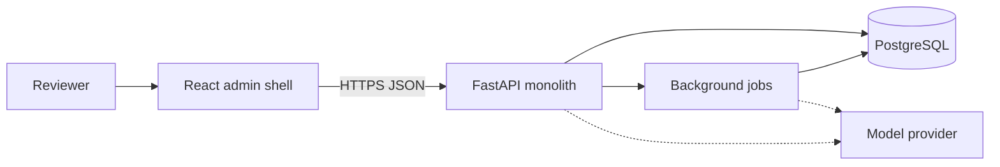
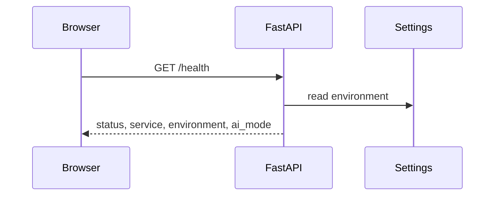
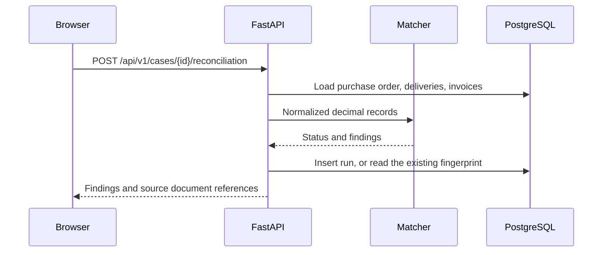
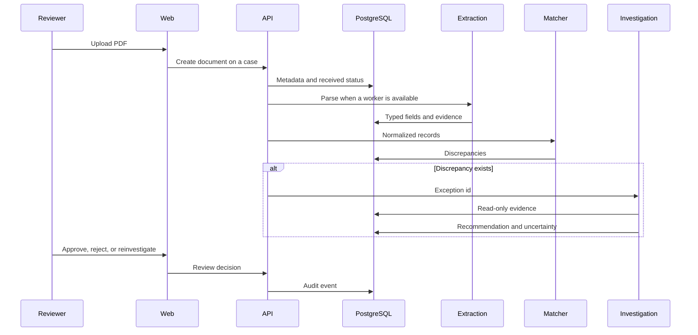
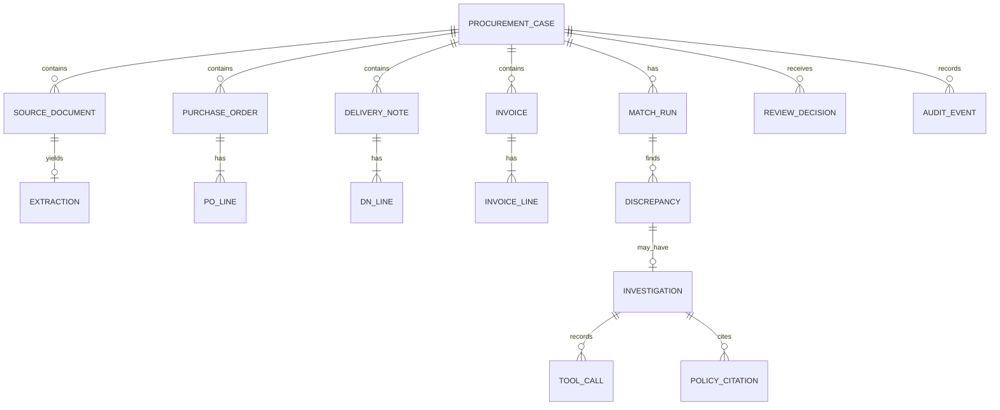
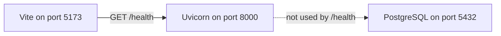
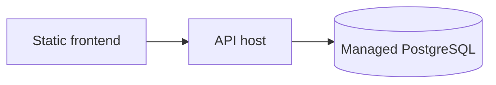

# ProcureFlow AI — Architecture

**Status:** foundation plus the procurement domain and deterministic matcher, updated 2026-11-16.  
**Implemented today:** a modular FastAPI process, configuration, structured request logs, `GET /health`, SQLAlchemy models and Alembic revisions for suppliers, cases, source documents, purchase orders, delivery notes, invoices, and reconciliation runs, a pure three-way matcher, a development-only synthetic seed, versioned case APIs, a mock AI provider, Docker Compose for local PostgreSQL, GitHub Actions for backend tests (with PostgreSQL) and the frontend build, and a React admin shell with an overview and a procurement cases screen.

Extraction, retrieval, investigation, review decisions, and deployment are still designs. They have not been validated with production traffic, load tests, or paid model calls. Uncertain choices are marked as proposals.

The product intent lives in [PROJECT_VISION.md](PROJECT_VISION.md). This file is the technical reference for subsequent work.

## Architectural overview

ProcureFlow AI is a modular monolith. One backend process owns the HTTP API, the domain rules, and the persistence boundary. Long-running work can later move to a worker in the same codebase. The frontend is a separate static application.

The monolith is a deliberate first shape. The workflows share one database and one transaction model. Splitting them into services would add network failure modes before there is a scaling measurement that justifies the split.



Solid arrows are the foundation we can run locally, except the worker, which is not implemented. Dashed arrows are the planned model boundary. In the default configuration the provider is an in-process mock and opens no network connection.

## Principles

1. **Interpretation and authority are different components.** A model may propose structure or an explanation. Quantities, money, tolerances, and match verdicts are computed in tested Python.
2. **Contracts are explicit.** HTTP payloads, extraction records, tool inputs, and tool outputs are Pydantic models. Invalid data is a result, not a guessed value.
3. **Side effects are narrow.** The investigation agent, when it exists, gets read-only tools. It cannot approve a payment.
4. **State transitions are visible.** Processing status, match status, investigation status, and review decisions are stored. Private chain-of-thought text is not stored.
5. **Untrusted input stays data.** Uploaded files and retrieved text are not instructions to the application.
6. **No speculative layers.** A module is added when a behavior needs it. The current tree does not contain empty domain services.

## Major components

| Component | Responsibility | Status |
| --- | --- | --- |
| React shell | Navigation, theme, overview, and procurement cases | Implemented |
| FastAPI application | HTTP, configuration, CORS, request logging, domain errors | Implemented |
| Settings | Environment and `.env` loading, including `AI_MODE` | Implemented |
| AI provider boundary | `complete()` contract, mock implementation, rejection of `openai` | Implemented |
| Persistence | Engine, session, procurement tables, Alembic through `20261116_0002` | Implemented |
| Case and reconciliation API | List, detail, run, and read findings under `/api/v1` | Implemented |
| Matching engine | Pure decimal comparison and persisted findings | Implemented |
| Synthetic seed | Idempotent fixtures for five scenarios, development environments only | Implemented |
| Document intake | File checks, storage reference, case association, status | Planned |
| Extraction pipeline | Typed fields and evidence from a document | Planned |
| Normalization | Map extractions onto purchase orders, deliveries, and invoices | Planned |
| Investigation workflow | Bounded tool use and a structured recommendation | Planned |
| Policy retrieval | Chunking, embeddings, citations, lexical fallback | Planned |
| Review and audit | Human decision and trace of state changes | Planned |
| Worker | Asynchronous jobs, retries, idempotency keys | Planned |
| External ERP | Simulated outbound adapter | Planned |

### Backend layout

```
backend/
  app/
    main.py                 # process composition
    api/routes/             # health and /api/v1 procurement routes
    api/presenters.py       # ORM rows to response models
    schemas/                # API contracts
    domain/matching/        # pure matcher, no I/O
    domain/scenarios.py     # synthetic fixtures
    services/               # queries, persistence, seed
    core/                   # settings and logging
    db/                     # engine, session, SQLAlchemy models
    ai/                     # provider contract, mock, factory
  alembic/                  # migration chain
  tests/
```

HTTP stays in `api`, request and response models in `schemas`, and SQLAlchemy models in `db`. The matcher does not import FastAPI or SQLAlchemy.

### Frontend layout

The UI is the MIT-licensed [shadcn-admin](https://github.com/satnaing/shadcn-admin) template, commit `e16c87f213a5ba5e45964e9b67c792105ec74d26`, with sample product pages removed. The license file remains in `frontend/LICENSE`. Shared UI primitives, the sidebar shell, theme controls, and error pages remain because later case and review screens will need them.

`src/lib/api.ts` is the backend client. It validates health, cases, seed, and reconciliation payloads with Zod.

The route group is still named `_authenticated` because that is the template's pathless layout. It does not check a session.

## Main data flows

### Flow implemented now



`/health` does not open a database connection and does not build an AI provider. It reports the configured mode so a mis-set `AI_MODE` is visible. It is a liveness check, not readiness.

### Reconciliation flow implemented now

The cases API reads PostgreSQL. Triggering reconciliation loads the stored lines, calls the pure matcher, and commits one run plus its findings. A second trigger with the same lines and the same engine version returns that run instead of inserting another. The browser does not calculate quantities.



### Target document flow



Extraction and investigation are asynchronous in the target design because parsing and model calls are slow and fallible. The matcher itself is synchronous and pure: given records, it returns a report. The API persists that report inside a transaction.

## Target domain model

These tables exist. Extraction, investigation, review, and audit records are still absent. A case has one purchase order, zero or more delivery notes, and zero or more invoices. Money and quantity columns are `NUMERIC(18, 4)`. API JSON sends them as decimal strings.



Supporting records, also planned:

- **Product match candidate.** A possible link between lines, with a reason such as shared identifier, shared reference, or semantic similarity. Only an identifier match or an accepted human decision authorizes a financial comparison.
- **Policy document and chunk.** Retrieval corpus. A citation points at a chunk id, not at a free-text memory of the policy.
- **Usage record.** Provider, model, token counts, estimated cost, and the workflow id that caused them.
- **Idempotency key.** On document processing, so a retry does not create a second extraction result.

Money is `NUMERIC` in PostgreSQL and `Decimal` in Python. Floats are not used for quantities or prices.

## API design principles

- Resource-oriented JSON under a versioned prefix when the first business route appears. `/health` stays at the root so a process probe does not depend on the version prefix.
- Request and response models are the contract. The database model is not the response model.
- Errors use a stable `code` and a human `detail`. Validation errors name the field. They do not echo secrets or document contents by default.
- Write operations that can be retried take an idempotency key.
- The browser origin is an explicit CORS allow-list (`CORS_ORIGINS`). Credentials are not paired with `*`.
- OpenAI credentials are read only on the server, and only by the real provider once it exists. No response schema includes them.

## Document processing pipeline

Planned stages:

1. **Accept.** Restrict content type and size. Reject empty files. Store the bytes, or a pointer to them, and a checksum.
2. **Extract.** A model, or a deterministic parser when the layout allows it, fills a Pydantic extraction schema: document type, numbers, parties, dates, currency, lines, totals, and taxes. Each field may carry a page and a source snippet. Absent fields stay absent.
3. **Validate.** Contradictions, such as a line total that does not match quantity times price, are recorded. They are not silently corrected.
4. **Normalize.** Map the extraction onto the internal purchase order, delivery note, or invoice. Unit mismatches and missing references become review flags.
5. **Match.** Run the engine below.
6. **Investigate** only when the match report contains an exception.

The pipeline state is an explicit enum on the document or job, for example `received`, `extracting`, `extracted`, `needs_review`, `failed`. A failed stage stores the error class and is safe to retry when the idempotency key matches.

## Matching engine

Implemented as `reconcile` in `app/domain/matching/engine.py`. It is a pure function: normalized records in, a report out. It does not call a model, a database, or the clock. Repeated calls with the same input return the same report. Persisted runs are idempotent on a SHA-256 of the canonical input plus engine version `1`.

Lines align only when they share a product code. A blank code is missing. Similar or identical descriptions do not authorize a financial comparison; those lines produce `UNCERTAIN_PRODUCT_MAPPING` and the run status is `NEEDS_REVIEW`. That status outranks `EXCEPTION`, because an unresolved identity can make a quantity gap misleading. Findings still keep their own status.

Comparison rules that are implemented:

1. One purchase order per case. A missing purchase order is `MISSING_PURCHASE_ORDER`. A delivery note or invoice that omits the purchase-order number is `MISSING_REFERENCE`. A cited number that is not the case purchase order is `REFERENCE_MISMATCH`. Quantity comparison still uses the lines already attached to the case.
2. Delivery quantities for one product code are summed across delivery notes. Invoice quantities are summed the same way. A missing side is zero for that product.
3. Material gaps use an absolute tolerance. The default is zero, so `100` and `80` produce `ORDERED_NOT_DELIVERED` and `INVOICED_WITHOUT_DELIVERY` with difference `20`.
4. Invoice and purchase-order unit prices are compared with `Decimal` when the unit and the currency are each a single value. A difference is `PRICE_MISMATCH` and is signed invoice minus purchase order.
5. More than one unit, after case-insensitive comparison, is `UNIT_MISMATCH`. Quantities and prices are not subtracted and no conversion table is applied. `BAG` and `KG` stay different. `bag` and `BAG` are the same unit.
6. More than one currency is `CURRENCY_MISMATCH`. No exchange rate is invented. A priced line with no currency is `MISSING_CURRENCY`.

Run status is `MATCHED` only when every finding is `MATCHED`. The five synthetic scenarios are `CASE-A-CLEAN`, `CASE-B-QUANTITY`, `CASE-C-AMBIGUOUS`, `CASE-D-PARTIAL`, and `CASE-E-PRICE`.

The earlier proposal also included duplicate detection, stated-total recomputation, and tax comparison. Those are not implemented. Semantic candidate matches are not implemented either; the matcher does not propose that two descriptions are the same product.

## Agent workflow design

The investigation is the part that should be agentic. Matching stays deterministic.

Proposal: a LangGraph state machine whose model-controlled step is tool selection, not the whole business process. A deterministic node loads the discrepancy. The model chooses among read-only tools. Another deterministic node checks budgets and writes the validated output.

Illustrative tools, all read-only:

- `get_purchase_order`
- `get_delivery_notes`
- `get_invoice`
- `get_procurement_case`
- `get_matching_results`
- `search_procurement_policy`
- `get_supplier_history`

Tool arguments and results are Pydantic models. The graph keeps counters for tool calls, model steps, tokens, and estimated cost. Limits are configuration. When a limit is hit, the state ends as `budget_exceeded` or `step_limit` and the recommendation, if any, cannot say that the invoice is approved.

Other termination conditions: a validated recommendation, an explicit `insufficient_evidence` result, a tool failure after the retry policy, or a timeout. Retries apply to transient tool and provider failures, not to a disagreement in the documents.

The persisted investigation contains: exception id, status, tool names and their validated inputs and outputs, policy citations, findings, recommended action, unresolved issues, and usage. It does not contain hidden chain-of-thought. A confidence field, if added, is an uncalibrated self-report and must be labeled that way, or omitted. This project should prefer omission until there is an evaluation that calibrates it.

There is no tool for payment, posting, or changing a review decision. Those actions are HTTP calls made by the reviewer.

Prompt injection is handled by construction: document text is passed as tool data, tool schemas reject unexpected fields, and the system instruction tells the model that document text cannot authorize a tool or a decision. That instruction is not sufficient by itself. The tool layer is the control.

LangGraph is a proposal. It should be introduced with the first real branching investigation, not as an unused dependency. If a simpler explicit state machine can express the first agent honestly, that is preferable until the branch logic is actually model-driven.

## RAG architecture

Proposal: store procurement policy in the same PostgreSQL database, using pgvector. The local Compose image is already `pgvector/pgvector:pg16` so the extension can be enabled later without swapping servers. The baseline migration does **not** create the extension. That decision is easy to reverse and avoids implying that retrieval exists.

Planned corpus:

- approval policy
- discrepancy handling rules
- delivery acceptance policy
- supplier-specific conditions
- tolerance rules

Pipeline: parse, chunk with stable ids, embed with the configured model, store text plus metadata (document, section, effective date). Retrieval returns the chunk id and text. The answer cites those ids. If chunks conflict or nothing relevant is retrieved, the result says the evidence is insufficient.

Identifiers, document numbers, and money amounts are also retrieved by equality or lexical search. Semantic search is not the only path to an invoice number.

Embeddings are a paid call in live mode and must go through the same budget accounting as chat completions. Until the corpus exists, no embedding client is installed.

## Persistence and state management

- PostgreSQL is the system of record.
- SQLAlchemy 2 is the ORM and the core expression layer. Sessions are request-scoped, `autoflush` is off, and `expire_on_commit` is off so loaded values remain readable after commit. This session policy is configured now and unused by routes.
- Alembic owns the schema. The head revision is `20261116_0002`. `20261116_0001` remains an empty baseline.
- A transaction wraps one state change: saving an extraction, saving a match run, or saving a review decision. The matcher does not open a session.
- Jobs, when added, record `queued`, `running`, `succeeded`, and `failed`, plus attempt count and the last error class. The worker claims work in a transaction so two workers cannot run the same job.

## Security boundaries

| Boundary | Rule |
| --- | --- |
| Browser | Receives only `VITE_` configuration. The only value shipped today is the API base URL. |
| API process | Reads `DATABASE_URL`, `AI_MODE`, and, later, `OPENAI_API_KEY` from the environment. |
| Repository | `.env.example` contains local defaults and a commented key name. Real `.env` files are gitignored. |
| Model provider | Not installed. `AI_MODE=openai` raises `RealProviderDisabledError` before any client object exists. |
| Uploads | Not accepted yet. When they are, size and content type are enforced and files are stored outside the source tree. |
| Logs | Request id, method, path, status, and duration. Not bodies, not API keys, not chain-of-thought. |
| Tools | Planned read-only surface. No shell, no arbitrary HTTP from the model. |

Local Compose credentials (`procureflow` / `procureflow`) are development defaults. They are not a deployed secret, and they must not be reused on a public host.

CORS is an allow-list. Rate limiting is not implemented; add it before any route can trigger a paid call.

## Error handling strategy

- Invalid input: HTTP 422 with field errors.
- Missing entity: HTTP 404.
- Conflict, including an idempotency mismatch: HTTP 409.
- Provider disabled or budget exceeded: a domain error mapped to a client-visible status, with no partial "success" recommendation.
- Unexpected exception: HTTP 500 with FastAPI's default behavior. The server log includes the exception class and the request id. Domain errors use `{"code", "detail"}`.
- Request ids from `X-Request-Id` are echoed when they are short, ASCII, and printable. Otherwise the server generates one. This is implemented.

## Observability and testing strategy

Implemented:

- JSON logs on the root logger.
- Request id, method, path, status, and duration on completed requests.
- API tests for `/health`, CORS for the configured origin, and request-id handling.
- Provider tests: mock output is deterministic and costs zero; `openai` is rejected; the OpenAI SDK is not installed.
- An engine test that the configured URL is parsed without opening a connection.
- Matcher unit tests for scenarios A–E, decimal sums, a 0.001 price gap, incompatible units, incompatible currencies, and missing product codes.
- API tests against PostgreSQL for seed idempotency, reconciliation replay, and the quantity check constraint. They skip when PostgreSQL is not reachable. CI starts PostgreSQL.
- A migration test that the Alembic head is `20261116_0002`, plus a round trip down to the baseline and back up when PostgreSQL is running.

Planned, in the order the features appear:

- Tool tests with a fake case fixture and no model.
- Recorded or mock model responses for extraction and investigation.
- A small evaluation runner over the synthetic dataset.
- Usage records for tokens and estimated cost.
- Trace ids that tie a request to a job and an investigation.

OpenTelemetry is a reasonable later addition. It is not part of the bootstrap, because there is no workflow span worth exporting yet.

## Local development architecture



- Frontend: React, TypeScript, Vite, Tailwind, shadcn/ui, pnpm.
- Backend: Python 3.12, uv, FastAPI, Pydantic, SQLAlchemy, Alembic, pytest, Ruff.
- Database: Docker Compose service `postgres`, image `pgvector/pgvector:pg16`, host port 5432.
- The health check and the current tests run without Docker. Migrations and any future repository test need the database.
- The documented API bind and the frontend default are `127.0.0.1`, not `localhost`. On this machine `localhost` resolves to IPv6 first, and the API listens on IPv4 only. CORS allows both `http://localhost:5173` and `http://127.0.0.1:5173`.

Configuration files:

- Repository root `.env` for the backend. See `.env.example`.
- `frontend/.env` for `VITE_API_BASE_URL` only.

## Proposed deployment architecture

Not provisioned. No host, database project, or API key has been created.



- Frontend as static files, GitHub Pages if the build-time API URL is acceptable.
- API as a separate service. Render is one candidate.
- Managed PostgreSQL. Supabase is one candidate because it can provide Postgres; pgvector availability must be confirmed on the chosen plan before retrieval work depends on it.
- `AI_MODE=mock` on any public instance until a budget and an authentication story exist.
- Secrets only in the host's environment, never in the frontend build.

These providers are options. The choice is open and has not been tested.

## Cost control strategy

Implemented:

- `AI_MODE` is `mock` or `openai`.
- Default is `mock`.
- The mock records zero tokens and zero cost and does not take a model name from the network.
- `openai` is a recognized value so configuration is explicit, and the factory refuses it.
- The OpenAI package is not a dependency, which is tested.

Planned before the first real call:

- A provider implementation that records input tokens, output tokens, model, and an estimated USD cost from a price table kept in configuration.
- Per-workflow ceilings on cost and tool iterations.
- A hard failure when the ceiling is crossed.
- No anonymous route that can call the live provider.
- An explicit decision before spending the roughly $5 experimentation budget.

The price table will be an estimate. Provider invoices remain the actual cost. The application must not present the estimate as an invoice.

## Technical trade-offs

| Choice | Why | What we give up | Confidence |
| --- | --- | --- | --- |
| Modular monolith | One transaction boundary and a small deployment | Independent scaling of extraction | Accepted for the MVP. Revisit only with a measurement. |
| Sync SQLAlchemy sessions | Matches the current request style and is easy to test | Non-blocking database IO | Accepted until a worker needs async. |
| Pure matcher | Same input, same report, no model flake | It cannot resolve a description by itself | Implemented. Descriptions are not identifiers. |
| No domain tables yet | Avoids a schema we would immediately rewrite | The database looks empty | Superseded. Revision `20261116_0002` creates the case and reconciliation tables. |
| LangGraph for investigation only | The branchy part is tool choice | Another framework if the first agent is a straight line | Proposal. Do not add it early. |
| pgvector in Postgres | One database, citations next to the case | A specialized vector service | Proposal. Image is selected; extension is not enabled. |
| Mock provider as the default | The repo can be cloned and tested at no cost | Live demos need a separate, capped deployment | Accepted. |
| shadcn-admin shell | Accessible layout and UI primitives under MIT | We must maintain a fork of the template | Accepted. Sample pages were removed so the UI does not show a fictional product. |

## Architectural decision records

### ADR-001 — Modular monolith

- **Status:** Accepted
- **Context:** The system needs an API, a database, and later a worker and a model. Traffic does not exist.
- **Decision:** One Python service and one database. Workers, when added, live in this repository and share the model layer.
- **Consequences:** Deployment stays simple. A later split is possible at the domain package boundary.
- **Validation:** None beyond local tests of the process. No load test has been run.

### ADR-002 — Deterministic authority for money and quantity

- **Status:** Accepted. The matcher is implemented.
- **Context:** Model output is useful for language and weak as an accounting system.
- **Decision:** Matching, tolerances, and quantity and price differences are ordinary code with fixtures. Models may later extract text and explain exceptions. They do not calculate the match.
- **Consequences:** Financial tests do not need API keys. Totals, taxes, and duplicate invoices are not compared yet.
- **Validation:** Unit tests cover the five scenarios, decimal precision, mixed units, and mixed currencies. They do not call a model.

### ADR-003 — Investigation may be agentic; matching may not

- **Status:** Proposed
- **Context:** Exception handling needs different evidence for different discrepancies. Three-way arithmetic does not.
- **Decision:** Use an explicit tool-using workflow for investigation. Keep the matcher a function. Prefer LangGraph only when the control flow is genuinely model-selected.
- **Consequences:** The agent can be bounded and audited. We do not pretend a fixed script is an agent.
- **Validation:** Not started. This ADR should be revised if the first investigations turn out to be a single obvious tool sequence.

### ADR-004 — pgvector in the primary database

- **Status:** Proposed
- **Context:** The policy corpus is small. A separate vector database is another service to run.
- **Decision:** Plan on PostgreSQL with pgvector. Use the pgvector Docker image locally. Do not enable the extension until the retrieval migration exists. Keep lexical lookup for exact identifiers and amounts.
- **Consequences:** Retrieval and cases share backup and transactions. Embedding quality and index choice are untested.
- **Validation:** Not started. Confirm the managed Postgres target supports pgvector before relying on this ADR for deployment.

### ADR-005 — Mock provider by default, real client not installed

- **Status:** Accepted
- **Context:** Paid calls need a budget and a reason. The bootstrap has neither a prompt nor a workflow.
- **Decision:** `AI_MODE=mock` is the default. The factory rejects `openai`. The SDK is absent so an accidental call has no client to use.
- **Consequences:** Live mode is a deliberate later change: add the dependency, implement the provider, record cost, and keep the public default on mock.
- **Validation:** Unit tests cover the mock and the rejection. No network assertion beyond the absence of the SDK.

### ADR-006 — Admin template, sample features removed

- **Status:** Accepted
- **Context:** The frontend needs an accessible shell. Building one from zero is not the point of the project. Shipping the template's tasks, chats, users, and fake analytics would look like a product that does not exist.
- **Decision:** Start from shadcn-admin, keep the license and attribution, and delete sample domain pages. The overview reads `/health`. The cases screen reads the procurement API.
- **Consequences:** Later screens inherit layout, theme, and UI primitives. Unused primitives remain in the tree because removing them now would fight the next screens. Upstream updates will need a manual merge.
- **Validation:** The production build is the check. Browser component tests from the template still require Playwright and are not part of CI.

### ADR-007 — Baseline migration, then the domain schema

- **Status:** Accepted. The baseline is unchanged. The domain revision is added after it.
- **Context:** Alembic was wired before the first real schema. The reconciliation contract is now tested, so the tables can exist.
- **Decision:** Revision `20261116_0001` still upgrades and downgrades with no operations. Revision `20261116_0002` creates the procurement tables, numeric columns, foreign keys, and check constraints.
- **Consequences:** `alembic upgrade head` creates the domain schema. Downgrade returns to the empty baseline.
- **Validation:** With PostgreSQL running, tests downgrade to `20261116_0001`, upgrade to head, and reject a zero quantity. `alembic check` compares the models with that database.

## Capability matrix

| Capability | Implemented | Planned |
| --- | --- | --- |
| `GET /health` | Yes | Readiness check that pings PostgreSQL |
| Settings and CORS | Yes | Rate limiting on paid routes |
| Structured request logs and request ids | Yes | Workflow and tool-call traces, metrics |
| SQLAlchemy session and Alembic | Yes, through `20261116_0002` | Review, audit, and retrieval tables |
| PostgreSQL via Compose, pgvector image | Local database and domain tables | Extension and retrieval tables |
| AI provider interface and mock | Yes | OpenAI provider, usage records, budgets |
| LangGraph investigation | No | Bounded read-only investigation |
| Extraction, RAG, review | No | After the matcher |
| Deterministic three-way matching | Yes, on stored lines | Extraction into those lines |
| Authentication and roles | No | Before any shared deployment |
| CI | Backend tests, PostgreSQL service, frontend build | Hosted environment checks |
| Deployment | No | Static frontend, hosted API, managed Postgres |

## Repository map

```
.
├── PROJECT_VISION.md
├── ARCHITECTURE.md
├── README.md
├── .env.example
├── docker-compose.yml
├── .github/workflows/ci.yml
├── backend/
│   ├── pyproject.toml
│   ├── alembic/
│   ├── app/
│   └── tests/
└── frontend/
    ├── LICENSE
    └── src/
```
